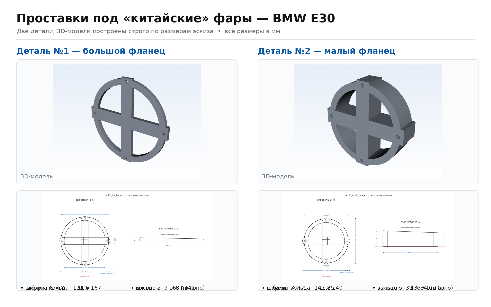
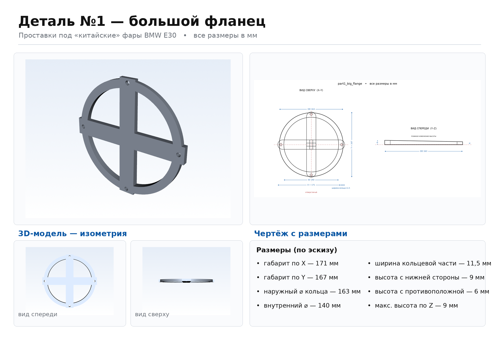
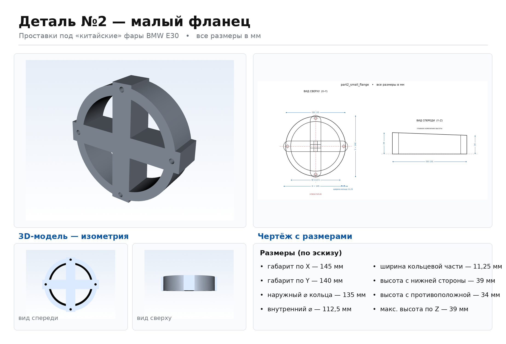

# Проставки под «китайские» фары — BMW E30

Параметрические 3D-модели двух переходных проставок (фланцев), которые
ставятся между кузовом BMW E30 и неоригинальными («китайскими») фарами.
Модели построены строго по размерам из эскиза.

| | Деталь №1 | Деталь №2 |
|---|---|---|
| Файл модели | [`models/part1.step`](models/part1.step) | [`models/part2.step`](models/part2.step) |
| Меш для печати | [`models/part1.stl`](models/part1.stl) | [`models/part2.stl`](models/part2.stl) |
| Габарит по X | 171 мм | 145 мм |
| Габарит по Y | 167 мм | 140 мм |
| Наружный ⌀ кольца | 163 мм | 135 мм |
| Внутренний ⌀ | 140 мм | 112,5 мм |
| Ширина кольцевой части | 11,5 мм | 11,25 мм |
| Высота, нижняя сторона | 9 мм | 39 мм |
| Высота, противоположная сторона | 6 мм | 34 мм |
| Макс. высота по Z | 9 мм | 39 мм |

Обе детали — кольцо, у которого стенка с одной стороны высокая, а с
противоположной низкая. Верхняя поверхность — наклонная плоскость,
поэтому высота меняется **плавно** от одной стороны к другой, как и
требует эскиз.

## Изображения

[](renders/overview.png)


| Деталь №1 | Деталь №2 |
|---|---|
| [](renders/part1_poster.png) | [](renders/part2_poster.png) |

* `renders/partN_poster.png` — сводный лист: 3D-вид, чертёж, таблица размеров
* `renders/partN_drawing.png` — чертёж с проставленными размерами (вид сверху + вид спереди)
* `renders/partN_iso.png`, `partN_top.png`, `partN_front.png` — отдельные виды

## Структура репозитория

```
cad/
  adapter.py   — параметрическая модель (CadQuery)
  export.py    — выгрузка STEP + STL
  render.py    — 3D-визуализация (VTK)
  drawing.py   — чертежи с размерами (matplotlib)
  poster.py    — сборка сводных листов (Pillow)
models/        — готовые STEP и STL
renders/       — изображения
docs/ANALYSIS.md — разбор эскиза, допущения, что осталось уточнить
```

## Как пересобрать

```bash
pip install cadquery vtk matplotlib pillow

python cad/export.py    # STEP + STL
python cad/render.py    # 3D-виды      (нужен Xvfb в headless-среде)
python cad/drawing.py   # чертежи
python cad/poster.py    # сводные листы
```

В headless-окружении рендер запускается так:

```bash
xvfb-run -a python cad/render.py
```

## Изменение размеров

Все размеры собраны в одном месте — в `AdapterSpec` в `cad/adapter.py`.
Меняете число — пересобираете, геометрия перестраивается автоматически.

```python
spec = adapter.spec_part1()   # od, id, height_lower, height_upper, width, contour_height, ...
solid = adapter.build(spec)
```

## Что стоит проверить перед печатью

Часть размеров на эскизе читалась неуверенно (диаметры отверстий, их
координаты, толщина «ушей»). Подробный разбор — в
[`docs/ANALYSIS.md`](docs/ANALYSIS.md). Перед изготовлением сверьте эти
величины с реальной деталью.
